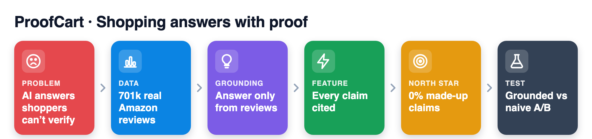
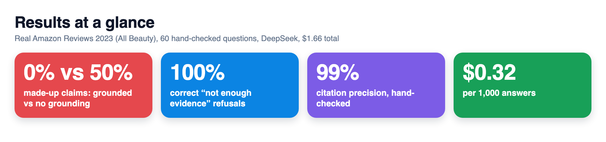
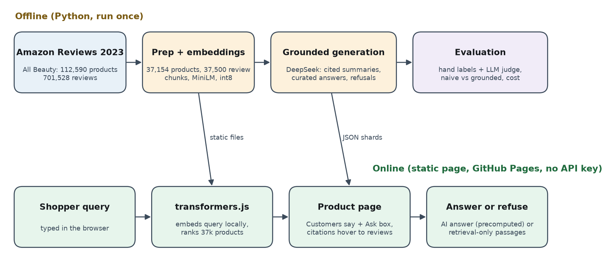
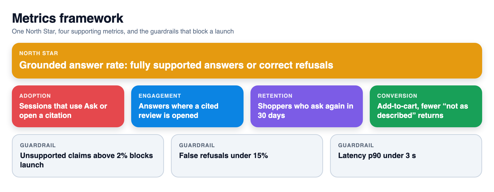
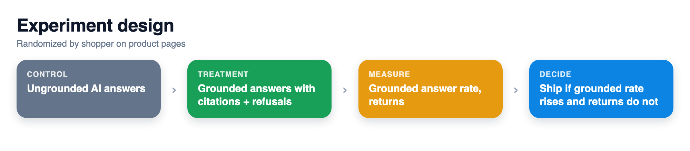

# ProofCart: a Rufus-style shopping assistant that answers only from real reviews, with 0 of 82 hand-checked claims unsupported vs 50% without grounding

> **PM case study + working prototype** · AI shopping assistant (Rufus-style Q&A, "Customers say" summaries, semantic search) · Real Amazon products and reviews (Amazon Reviews 2023, All Beauty)

**▶ 60-second demo (plays automatically)**


**Live demo: [akhilesh360.github.io/proofcart](https://akhilesh360.github.io/proofcart/)**

## How it works





### Data

| | |
|---|---|
| **Dataset** | [Amazon Reviews 2023](https://huggingface.co/datasets/McAuley-Lab/Amazon-Reviews-2023), category All Beauty (`raw/review_categories/All_Beauty.jsonl` + `raw/meta_categories/meta_All_Beauty.jsonl`) |
| **Source** | McAuley Lab, UC San Diego. Hou et al. 2024, "Bridging Language and Items for Retrieval and Recommendation" ([arXiv:2403.03952](https://arxiv.org/abs/2403.03952)) |
| **License** | Released by the McAuley Lab for research use; cite Hou et al. 2024 and check the dataset page for terms. Code in this repo: MIT |
| **Size used** | 112,590 products and 701,528 reviews read. Search covers 37,154 products (3 or more text reviews). The assistant covers the 1,500 most-reviewed products (46 to 1,618 reviews each), using each one's 25 most helpful reviews (37,500 review passages) |
| **Real or simulated** | Products, titles, ratings, reviews: **real**. Search, summaries, answers, refusals, citations: **real model output** on real reviews. Eval labels: **real, hand-labelled by the author**. Human reading speed (238 wpm) and human support cost: **assumptions**, labelled where used |
| **AI models used + total cost** | Embeddings: all-MiniLM-L6-v2 (sentence-transformers offline, transformers.js `Xenova/all-MiniLM-L6-v2` in the browser), free. LLM: DeepSeek via the OpenAI-compatible API, requested as `deepseek-chat`; the API reported the serving model as `deepseek-flash` (DeepSeek-V4.1-Flash per DeepSeek's pricing page). **Total LLM spend: $1.66** (3,900 calls, 3.80M input + 0.45M output tokens, priced at DeepSeek's published peak rates, so an upper bound). Hard cap in code: $3.00 |

## 1. User and problem
Shoppers deciding on a product with hundreds or thousands of reviews. The questions that decide a purchase are specific ("will it fit my Dyson?", "does it irritate eyes?") and the answer is buried in reviews. Amazon already ships an AI assistant ([Rufus, announced Feb 2024](https://www.aboutamazon.com/news/retail/amazon-rufus)) and [AI-generated review highlights](https://www.aboutamazon.com/news/amazon-ai/amazon-improves-customer-reviews-with-generative-ai) ("Customers say", Aug 2023). The open problem is trust: a fluent answer that is not backed by any review is worse than no answer, because the shopper cannot tell the difference. In this repo, a plain LLM answering from the product title invented 50% of its factual claims (a 1-year warranty, a 400F max heat, "reviewers report longer lashes" when reviewers said the opposite).

## 2. Product goal
A shopper gets a correct, checkable answer to a product question in seconds: every claim links to the reviews that support it, and when reviews do not cover the question the assistant says "Not enough evidence in reviews" instead of guessing.



## 3. Solution and trade-offs
**Built**
- **Ask about this product.** Retrieve the 6 most relevant review passages (MiniLM embeddings), then the model answers only from them, citing passage numbers per claim, or refuses. Curated questions (5 per product for the 100 most-reviewed products) have precomputed AI answers; any new question gets a live, retrieval-only answer in the browser (top passages, or a refusal below a similarity threshold). The page labels which is which.
- **Ask across products.** Semantic search picks candidate products, retrieval runs inside each, and one grounded answer cites reviews from several products (8 precomputed examples).
- **"Customers say" with citations** for all 1,500 assistant products; each claim's numbers hover to the full review.
- **Semantic search** over 37,154 products, with the query embedded in the browser by transformers.js. No server and no API key, so it runs on GitHub Pages.
- **Evaluation harness**: hand labels, an LLM judge, a naive (no grounding) baseline, cost and latency logging.

**Prior art, and how this improves it.** Rufus and AI review highlights exist and work at Amazon scale. This project does not try to rebuild them. It shows two upgrades that make them trustworthy and measurable: (1) claim-level citations a shopper can check, and (2) an explicit refusal path with a measured correct-refusal rate. Both are cheap enough to run everywhere ($0.32 per 1,000 answers here).

**Trade-offs**
- Precomputed AI answers plus retrieval-only live answers, instead of a live LLM endpoint. This keeps the demo free, keyless and safe to host. The cost is that arbitrary new questions get evidence passages, not prose.
- 25 most helpful reviews per product as the evidence pool. This keeps the repo under 60 MB and cost tiny. The cost: rare facts buried in review 400 are missed, which is one cause of the 3 false refusals.
- Smallest current DeepSeek chat model with thinking mode off. This is cheap and fast (1.4 s median). Quality was good enough to reach 0 unsupported claims on the hand-checked set.

**Not built (on purpose)**: a live LLM endpoint, personalization or purchase history, image or video reviews, multi-turn chat memory, fake-review detection (one review in the data openly says the seller offered a free product for a 5-star review), and any Amazon branding.

## 4. North Star metric



**Grounded answer rate**: share of product questions that get either (a) an answer whose every claim is supported by a cited review, or (b) a correct "not enough evidence" refusal. Measured weekly on a stratified, hand-labelled sample of live questions. It rewards being helpful and honest together, and it falls if the assistant hallucinates or over-refuses.
On this repo's 60-question set: 57 of 60 = **95%** (the 3 misses are false refusals; no answer contained an unsupported claim).

## 5. Supporting metrics
- **Adoption**: share of product-page sessions that open "Ask" or hover a citation.
- **Engagement**: questions per session; share of answers where the shopper opens at least one cited review.
- **Retention**: share of shoppers who ask again within 30 days.
- **Conversion**: add-to-cart rate after a grounded answer vs no question asked, plus return rate for "didn't match description" (the real test of answer quality).

## 6. Guardrail metrics
| Guardrail | Threshold (launch blocker) | This repo |
|---|---|---|
| Unsupported-claim rate (hand-checked sample) | above 2% | **0%** of 82 answer claims; **0%** of 80 summary claims |
| Correct refusal on unanswerable questions | below 90% | **100%** (24 of 24) |
| False refusal on answerable questions | above 15% | **8%** (3 of 36) |
| Citation precision | below 95% | **99%** answers (107 of 108), **97%** summaries (318 of 328) |
| Cost per 1,000 answers | above $2 | **$0.32** |
| Answer latency p90 | above 3 s | **1.9 s** (API, offline batch) |
| Review/listing mismatch | any answer built on reviews of a different product | found 1 listing ("Electric Portable Bidet") whose reviews describe a nail drill; the grounded assistant refused all 3 bidet questions, while the naive model invented bidet facts |

## 7. Prioritization
Scored impact x reach / effort (1 to 5 each):
1. **Grounded Q&A with refusal** (5 x 5 / 3): highest risk in production AI shopping is a confident wrong answer, and every product page has questions. Built first.
2. **Cited "Customers say"** (4 x 5 / 2): same machinery, every product page. Built.
3. **Semantic search** (3 x 5 / 2): retailers already have strong search, so this is supporting. Built because it makes the in-browser demo work.
4. **Live LLM endpoint** (3 x 5 / 4): better UX for long-tail questions, but needs a backend, keys and abuse controls. Deferred.
5. **Fake-review weighting** (4 x 3 / 5): important, but its own project. Deferred.

## 8. Experiment and learning



**What the prototype shows (real numbers, this repo)**

| Eval | Grounded (ProofCart) | Naive (no grounding) |
|---|---|---|
| Unsupported claims, hand-checked | **0%** (0 of 82) | **50%** (63 of 126) |
| Unsupported claims, LLM judge | 0% | 52% (of 182) |
| Correct refusal, 24 unanswerable questions | **100%** | 54% |
| Answered, 36 answerable questions | 92% | 81% (the rest hedged with "the listing does not say") |
| Citation precision, hand-checked | 99% | n/a (no citations) |

60 hand-written questions over 20 products. I read every retrieved passage and every answer, labelled each question answerable or not from the reviews, and labelled each claim. Hedges and advice ("consult a doctor") were not counted as claims; facts in the product title counted as supported. The LLM judge agreed with my labels on 100% of grounded answer claims.

| "Customers say" summaries | Cited | Naive (same 15 reviews, no citations) |
|---|---|---|
| Unsupported, hand-checked (80 claims, 16 random products) | **0%** | n/a |
| Partially supported or overgeneralized, hand | 5% | n/a |
| Citation precision, hand | 97% | n/a |
| Unsupported, LLM judge (100 products, ~500 claims each) | 1% | 0% |
| Partially supported or overgeneralized, LLM judge | **11%** | **31%** |

Learning: when the model sees the reviews, outright invention is rare even without citations. The win from citations is precision (fully supported claims rise from 69% to 88%) and, more importantly, the shopper can check them. My labels and the judge matched on 87.5% of the 80 summary claims; disagreements were all supported vs partial.

| Search, 40 hand-written shopper queries | Precision@5 | MRR |
|---|---|---|
| Semantic (MiniLM, in the browser) | **0.79** | **0.93** |
| Keyword baseline | 0.72 | 0.86 |

Live retrieval-only answers: refusing when the best passage scores below 0.44 cosine gives the right answer-or-refuse call on 87% of the 60 questions with no model call (median best score 0.55 answerable vs 0.32 unanswerable).

**Efficiency.** Cuts the reading needed to answer a product question from a median of **2 reviews (372 words, about 1.6 min)** to one **35-word cited answer**. The mean is 4.9 reviews (753 words, about 3.2 min), and one question needed 23 reviews. Method: for each of the 36 answerable questions, I walked all of the product's reviews in most-helpful order and found the first one that answers it. Detection was done by the LLM in batches of 10, and I spot-checked 4 (3 exact, 1 lenient). Times use an **assumed** reading speed of 238 words per minute (Brysbaert 2019, *Journal of Memory and Language* 109). Caveats: helpful-first order already favors long, informative reviews, so this is a conservative baseline. The first answering review is also one opinion, while the cited answer shows both sides (20 of the 33 grounded answers to answerable questions present both sides, counted by contrast words such as "disagree" and "however").

**Cost.** $0.32 per 1,000 answers and $0.60 per 1,000 product summaries, so about **$0.0003 per answer**. For contrast, a human support agent answering the same question is **assumed** to cost about $3 per contact (an assumption, not a measurement).

**A/B design (next step)**
- **Unit**: shopper, 50/50, stratified by category. **Control**: current Q&A without citations or refusal. **Treatment**: ProofCart answers with citations and refusals.
- **Primary**: return rate for "not as described" within 30 days of a purchase that followed a question. **Secondary**: add-to-cart after a question, citation hover rate. **Guardrails**: the table in section 6, plus answer rate (treatment refuses more, so watch helpfulness).
- **Decision rule**: ship if "not as described" returns fall by at least 5% relative with p < 0.05 and no guardrail breaks. If add-to-cart falls by more than 1% because of refusals, tune the refusal threshold before shipping.
- **Power (assumption)**: at a 4% baseline return rate, detecting a 5% relative drop (0.2 points) at 80% power and alpha 0.05 needs roughly 150k question-led purchases per arm.

**What I'd do next**: widen the evidence pool past 25 reviews with a reranker to fix the false refusals; down-weight incentivized or unverified reviews; add a live endpoint behind a cost and abuse budget.

---

## How to run it
```bash
python3 -m venv .venv && .venv/bin/pip install -r requirements.txt
# data (about 540 MB) into data/raw/
B=https://huggingface.co/datasets/McAuley-Lab/Amazon-Reviews-2023/resolve/main/raw
curl -L -o data/raw/All_Beauty.jsonl $B/review_categories/All_Beauty.jsonl
curl -L -o data/raw/meta_All_Beauty.jsonl $B/meta_categories/meta_All_Beauty.jsonl
.venv/bin/python scripts/01_prep.py && .venv/bin/python scripts/02_embed.py
.venv/bin/python scripts/03_search_eval_dump.py && .venv/bin/python scripts/04_search_metrics.py
# LLM steps need DEEPSEEK_API_KEY in .env (gitignored); spend stops at $3.00
.venv/bin/python scripts/05_eval_answers.py && .venv/bin/python scripts/06_summaries.py
.venv/bin/python scripts/08_efficiency.py && .venv/bin/python scripts/07_showcase_qa.py && .venv/bin/python scripts/09_cross_product.py
.venv/bin/python scripts/11_metrics.py && .venv/bin/python scripts/10_build_site.py
python3 -m http.server 8000 --directory docs   # open http://localhost:8000
```
Hand labels live in `eval/` (`hand_labels_src.txt`, `summary_hand_labels.jsonl`, `search_labels.txt`); every number above is recomputed by `scripts/11_metrics.py` into `eval/metrics.json`.

